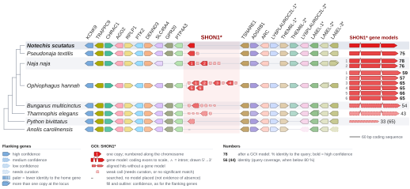

# SynVoy - Synteny Voyager

Synteny-guided discovery of divergent orthologs in unannotated genomes.

[](https://github.com/AndreasWz/SynVoy/actions/workflows/test.yml)
[](https://www.gnu.org/licenses/agpl-3.0)

---

## What it does

SynVoy finds the ortholog of a gene in other species **when the gene is too divergent or too short for a normal BLAST or MMseqs2 search to find it**. Instead of matching the gene's sequence against the whole genome, it uses the gene's **neighbouring genes**, whose order is often conserved across species, to find the matching region in each target genome. Then it searches for the gene only inside that region.

The target genomes need no annotation: SynVoy builds its own gene models in them. An annotation of the home genome (the genome your gene comes from) helps, but it is optional.

SynVoy is built for **divergent genes with few copies**, such as toxins or micro-exon genes. For large gene families it gives candidates to curate, not orthologs (see [Scope](#scope)).

<p align="center">
  
</p>
<p align="center"><sub>Example: a three-finger toxin gene of the tiger snake (<i>Notechis scutatus</i>) searched in six other snakes and a lizard, drawn as the print version of the anchor grid (<code>*_anchor_grid_print.svg</code>). Each row is a species and each column a gene: the searched gene in red, its neighbours on either side. A HIGH arrow is paler the lower its identity to the home gene; a MEDIUM, LOW or AMBIGUOUS arrow has a fixed pale fill. The outline gives the confidence: solid = HIGH, dashed = MEDIUM, dotted = LOW, sparser dots = AMBIGUOUS (needs curation). The panel on the right draws the exon structure of every copy of the searched gene, with its identity to the query (bold = HIGH). In the king cobra (<i>Ophiophagus hannah</i>) and the Indian cobra (<i>Naja naja</i>), SynVoy calls several copies side by side, numbered along the chromosome; the small pale marks next to them are weak calls (needs curation, or no significant match). The dash in the lizard's row means that no model was <i>placed</i> there, not that the gene is absent. The label <code>SHON1*</code> abbreviates the gene's NCBI product name, short neurotoxin 1 (a label ending in * is not an official gene symbol). The same run also writes the full version of this grid, with genome coordinates and details on hover (<code>*_anchor_grid.html</code>).</sub></p>

---

## How it works

1. SynVoy finds your gene in the home genome and takes its neighbouring genes, from the home annotation or, without one, from predicted genes.
2. In each target genome, it finds where those neighbours lie in the same order.
3. It searches for your gene only inside that stretch, with thresholds that would be useless across a whole genome, and builds a gene model for each hit.
4. It labels each model by how significant its match is in the place where the gene should be, and by whether another gene of the home genome explains it as well.

Genomes are searched from the closest relative outwards, and a gene found in a close relative joins the query set for the more distant ones. Every step and rule is in [docs/ALGORITHM.md](docs/ALGORITHM.md).

---

## Install

You need Linux on x86-64 and conda, best with mamba, which builds the tool environment faster: [Miniforge](https://github.com/conda-forge/miniforge) brings both ([docs/INSTALL.md](docs/INSTALL.md)). Nextflow, Java and all the tools are installed for you into a conda environment. On a Mac, read [docs/INSTALL.md](docs/INSTALL.md#macos) first.

```bash
git clone https://github.com/AndreasWz/SynVoy.git
cd SynVoy
./install.sh                    # creates the conda environment synvoy_env and checks its tools
./run_synvoy.sh --check-only    # checks that SynVoy is ready to run
```

On the first run, Nextflow builds a second environment from the same `environment.yml` for the pipeline's steps. This needs the network and takes from a few minutes to an hour, once.

To update SynVoy, run `git pull` in the `SynVoy` folder. `./run_synvoy.sh` prints the version it runs. Note it with your results, because another version can give different results, and give it when you report a problem. Docker, Singularity and clusters: [docs/INSTALL.md](docs/INSTALL.md).

---

## Run

You run SynVoy with **`./run_synvoy.sh`** from the `SynVoy` folder. It prints the version, checks the installation and starts the pipeline. It reads the paths you give it from the `SynVoy` folder, so give them relative to that folder, or as absolute paths.

There are two ways to give SynVoy your data:

- **Easy Mode**: you give the accession of your gene's protein, and SynVoy downloads the genomes from NCBI. *(The most common case.)*
- **Pro Mode**: you give your own genome files, for example unpublished assemblies.

### Easy Mode

```bash
./run_synvoy.sh --mode easy --query_id P01501 --max_genomes 5 --outdir results/my_run
```

| Option | What it is |
|---|---|
| `--query_id` | A UniProt or NCBI **protein accession** of your gene (here, `P01501` = honeybee melittin). |
| `--max_genomes` | How many related genomes to download and search. Start with `5`. |
| `--outdir` | Where to write the results. |

SynVoy reads the species from the accession and downloads its reference genome and related genomes. Two optional flags, if the automatic choice is not what you want:

- `--home_species "Apis mellifera"` names the home species yourself. Use it when SynVoy cannot read the species from your accession (it tells you).
- `--target_species "Bombus terrestris,Nomia melanderi"` names the species to search, instead of letting SynVoy choose related ones.

To search a protein sequence of your own instead of an accession, give it as a FASTA file together with its species: `--query my_protein.faa --home_species "Apis mellifera"`.

### Pro Mode

```bash
./run_synvoy.sh --mode pro \
  --query gene.faa \
  --home_species "Genus species" \
  --home_genome reference.fna \
  --home_gff reference.gff \
  --target_genomes genomes/ \
  --outdir results/my_run
```

| Option | What it is |
|---|---|
| `--query` | Your gene's protein, as a **FASTA** file. |
| `--home_species` | The species of the home genome, e.g. `"Apis mellifera"`. SynVoy uses it to order the target genomes by relatedness. Without it, SynVoy takes the name of the `--home_genome` file as the species (`Apis_mellifera.fna` is read as *Apis mellifera*), and stops when that name is a placeholder such as `reference.fna` or an assembly accession. |
| `--home_genome` | The genome your gene comes from (FASTA). |
| `--home_gff` | That genome's **gene annotation** (GFF3). *Optional but recommended:* with it, SynVoy takes the real neighbouring genes; without it, it predicts them, which is less reliable. |
| `--target_genomes` | The genomes to search. Simplest: a **folder** of genome FASTA files; `genomes/` uses every `.fna`, `.fa` or `.fasta` file in it, plain or gzipped, and ignores other files. You can also give a quoted glob (`"genomes/*.fna"`) or a comma-separated list; a listed file that does not exist stops the run. |
| `--target_gffs` | *Optional.* Annotations of the **target** genomes: a folder, glob or comma-separated list, matched to the genomes by file name or assembly accession. With them, a result also names the annotated gene it lies on. |

### Memory and the default profile

Without `-profile`, the launcher uses the memory-safe profile `auto,low_mem`, made for a laptop with 8 GB of memory: it runs one task of each step at a time, gives the search 4 GB, runs MMseqs2 at sensitivity 7.0 and builds no gene tree. No step of this profile asks for more than 4 GB, so it also runs on a laptop sold with 8 GB, which reports a little less. On a workstation or server, add `-profile standard` for full sensitivity (9.5) and the gene tree:

```bash
./run_synvoy.sh -profile standard --mode easy --query_id P01501 --max_genomes 10 --outdir results/my_run_standard
```

Other profiles, clusters and resuming a run: [docs/USAGE.md](docs/USAGE.md).

---

## Results

Everything is written to the folder given with `--outdir`. Nextflow keeps its work folder (`work/`), its record for `-resume` (`.nextflow/`) and its log (`.nextflow.log`) in the `SynVoy` folder; the figures keep a cache of species names in `~/.cache/synvoy/`, and ete3 keeps its copy of the NCBI taxonomy in `~/.etetoolkit/`. The files you will open first:

| File | What it is |
|---|---|
| `synvoy_report.json` | **The result.** `summary.headline` is the one-line answer, for example `3 ortholog(s) (2 high, 1 medium confidence); 1 need curation (1 gene order only); across 3 genome(s).`, where the last number counts the genomes with any model of your gene. `goi_dedup.records` lists the calls labelled HIGH, MEDIUM or AMBIGUOUS, one per target gene, with its coordinates, `confidence` and `goi_class` (a weak match where the gene should be is listed only in a genome without a counted call); LOW models are only counted. |
| `*_anchor_grid.html` | The full, interactive version of the figure above: the identity in every arrow, genome coordinates, details on hover. |
| `*_anchor_grid_print.svg` | The figure above at print size (at most 183 mm wide, text of 5 to 7 pt). Next to it, `*_anchor_grid_print.legend.txt` holds its legend text and `*_anchor_grid_print.source.tsv` a table of every cell. |
| `plot_inputs_*/` | Per genome: the gene models with their exon coordinates (`.gff`), and a table of every model with its evidence (`.homology.tsv`). |

With a gene tree (`-profile standard`), SynVoy also draws `*_anchor_grid_clades_print.svg`, which colours every copy of your gene by its clade in the tree, when a genome has several copies or a copy does not fit the species tree.

Every gene model of your gene gets one of four labels:

| Label | Meaning | Counted as an ortholog |
|---|---|---|
| `HIGH` | A significant match (E ≤ 1e-6) in the place where the gene should be, at least 10 bits better than its match to any other gene of the home genome, and a model that covers at least 70 % of the query (for a query with a signal peptide or GPI anchor, 70 % of its core is enough). | yes\* |
| `MEDIUM` | A significant match (E ≤ 1e-3) in the place where the gene should be, and no other home gene explains it as well. | yes\* |
| `AMBIGUOUS` | Needs curation: a significant match that another home gene explains as well, or a weak match in the slot where the gene should be. | no |
| `LOW` | No significant match: a fragment, a weak hit or a chance alignment. | no |

\* Except a record whose `goi_class` is `paralog_not_goi` (it belongs to another gene of the home genome) or `identity_coverage_decoupled` (a high identity over only a short part of the query). Such a record keeps its label but is not counted. The headline counts only the orthologs.

What every file contains, and how to read the report: [docs/OUTPUT.md](docs/OUTPUT.md).

---

## Scope

SynVoy is for **divergent genes with few copies**, found through conserved gene order. Know its limits:

- It is **not** a general ortholog finder for large paralog families or tandem arrays. There, treat `MEDIUM` and `AMBIGUOUS` calls as leads that need manual curation, not as findings. For genome-wide ortholog inference, use OrthoFinder or TOGA instead.
- It finds a gene **where the home genome's neighbourhood is conserved**. A gene that moved, or a locus the home genome does not have, is out of reach, with one exception: a well-conserved copy that moved only within the span of its old neighbours on the same chromosome is still found. A strong match anywhere else is listed in the report as found but not syntenic (`rejected_candidates`), and is not counted.

---

## Documentation

- [docs/QUICKSTART.md](docs/QUICKSTART.md): a first run, step by step (melittin, about 30 minutes).
- [docs/INSTALL.md](docs/INSTALL.md): installing with conda, Docker or Singularity, on a laptop or a cluster.
- [docs/USAGE.md](docs/USAGE.md): running SynVoy: modes, profiles and memory, clusters, resuming, troubleshooting.
- [docs/OUTPUT.md](docs/OUTPUT.md): every output file, and how to read the report.
- [docs/PARAMETERS.md](docs/PARAMETERS.md): every parameter, its default and when to change it.
- [docs/ALGORITHM.md](docs/ALGORITHM.md): what SynVoy computes, step by step, with every rule and default.
- [CHANGELOG.md](CHANGELOG.md): what changed between versions.

---

## License and citation

SynVoy is distributed under the **[GNU AGPLv3](LICENSE)**. If SynVoy contributes to your research, please cite it (GitHub's "Cite this repository" button gives the same from [CITATION.cff](CITATION.cff)):

> Weitz, F. A., & Koludarov, I. (2026). SynVoy: Synteny-guided orthology discovery (Version 1.0.1) [Computer software]. https://github.com/AndreasWz/SynVoy

<details>
<summary>BibTeX</summary>

```bibtex
@software{synvoy,
  author  = {Weitz, Frank Andreas and Koludarov, Ivan},
  title   = {SynVoy: Synteny-guided orthology discovery},
  year    = {2026},
  version = {1.0.1},
  url     = {https://github.com/AndreasWz/SynVoy}
}
```

</details>
